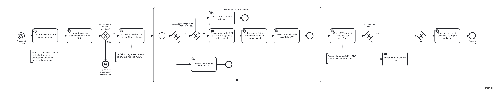

# Calçada Livre · Robô de triagem de ocorrências (RPA)

Componente de **Automação** da CitizenTech **Calçada Livre**, FIAP Global Solution 2026.2, Engenharia de Software 4º ano, disciplina *Robotic Process Automation* (profs. Bruno Diniz e Cibele Ribeiro).

## Integrantes

| Nome completo | RM |
|---|---|
| Carlos Ganzerli | 99840 |
| Paulo Lopes | 551137 |
| Lucas Bandeira | 98640 |
| Gustavo Melo | 98809 |

## Ficha Técnica do MVP

| Item | Conteúdo |
|---|---|
| Nome | Calçada Livre |
| Cidadão e território | Pessoas com deficiência, idosos e pais com carrinho de bebê em São Paulo (SP) |
| Problema em uma frase | Barreiras em calçadas (buracos, degraus, obstáculos, falta de rampa, trechos escuros) impedem a circulação e não chegam organizadas a quem pode corrigi-las |
| Proposta de valor | Mapear as barreiras com cidadãos, um robô inspetor e visão computacional, triar automaticamente e encaminhar à subprefeitura certa com prioridade |
| Componentes | App web com mapa (MVP), carrinho inspetor (Maker Lab), visão computacional, **robô de triagem (este repositório)**, pipeline de dados, assistente com LLM local, infraestrutura DevSecOps |
| Fontes de dados | Relatos do app, leituras do carrinho, detecções da câmera, previsão Open-Meteo, pontos de interesse (hospitais, escolas, terminais) |
| Modelos de IA | YOLO (detecção de barreiras), classificador embarcado no carrinho, LLM local (assistente) |
| URL e repositório | MVP: `<URL pública>` · MVP e infra: `<link do repositório calcada-livre>` · Este robô: `<link deste repositório>` |
| Indicadores de impacto | Tempo entre relato e encaminhamento; % de relatos triados sem intervenção humana; barreiras de prioridade alta perto de serviços essenciais |
| ODS | 11 (cidades sustentáveis: mobilidade acessível), 10 (redução das desigualdades), 3 (saúde e bem-estar: quedas evitadas) |

## O problema e o papel da automação

Sem o robô, alguém da operação teria de abrir cada relato, conferir se o endereço existe, procurar se a barreira já foi relatada, decidir a urgência, descobrir a subprefeitura responsável e montar um encaminhamento. Isso é lento, repetitivo e sujeito a erro, e o cidadão espera dias sem resposta.

O robô faz esse trabalho sozinho a cada 15 minutos: recebe ocorrências do app, do carrinho e da câmera, valida, elimina duplicadas, prioriza, encaminha e devolve o resultado ao MVP, onde o cidadão vê o status e o protocolo.

## Arquitetura

```
 App (cidadão) ─┐                                   ┌─> Mapa e tabela do MVP (status, prioridade, protocolo)
 Carrinho ──────┼─> API do MVP (ocorrências) <──────┤
 Visão (YOLO) ──┘        ▲            │             └─> Big Data (indicadores)
 Lote CSV (entrada/) ────┼────────────┤
                         │ PATCH      │ GET status=nova
                    ┌────┴────────────▼─────┐
                    │  ROBÔ DE TRIAGEM      │──> Open-Meteo (previsão de chuva)
                    │  (Python, este repo)  │──> saida/: CSV + e-mail simulado por subprefeitura
                    └───────────┬───────────┘──> Alerta de prioridade alta (webhook ou log)
                                └──> logs/: auditoria em JSON Lines
```

## Fluxo do processo

O BPMN completo está em [`docs/processo-triagem.bpmn`](docs/processo-triagem.bpmn) (abre no [bpmn.io](https://demo.bpmn.io)) e em imagem em [`docs/processo-triagem.png`](docs/processo-triagem.png).



1. **Importa lotes CSV** da pasta `entrada/` (por exemplo, o carrinho sem Wi-Fi exporta as leituras). Arquivo inválido vai para `entrada/rejeitados/`.
2. **Lê as ocorrências `nova`** na API do MVP.
3. **Consulta a previsão de chuva** (Open-Meteo, sem chave).
4. **Para cada ocorrência** (repetição):
   - **Decisão 1, validade:** coordenada fora de São Paulo, tipo desconhecido, detecção da câmera sem foto ou com confiança abaixo de 0,5 → `quarentena`, com o motivo.
   - **Decisão 2, duplicidade:** mesmo tipo a até 20 m nos últimos 7 dias → `duplicada`, apontando a original.
   - **Decisão 3, prioridade:** prioridade base pelo tipo; a até 150 m de hospital, escola ou ponto de ônibus → `alta`; chuva prevista (≥ 60%) sobe um nível.
   - Atribui a **subprefeitura**, gera o **protocolo** (`CL-AAAAMMDD-XXXXXXXX`) e **remove telefone, e-mail e CPF** que o cidadão tenha escrito na descrição.
   - Grava tudo de volta na API com status `encaminhada`.
5. **Gera o pacote de encaminhamento**: um CSV e um e-mail `.eml` por subprefeitura em `saida/`.
6. **Alerta** as ocorrências de prioridade alta (webhook do Discord/Slack/Teams ou, sem webhook, no log).
7. **Registra o resumo** da execução no log de auditoria.

> **O encaminhamento é simulado.** Nada é enviado ao SP156 nem à prefeitura. Os arquivos em `saida/` mostram o que seria enviado.

## Regras de negócio

| Regra | Valor | Onde mudar |
|---|---|---|
| Área válida | Município de São Paulo (lat −24,01 a −23,35; lon −46,83 a −46,36) | `regras.py` |
| Confiança mínima da câmera | 0,5 | `CONFIANCA_MINIMA_VISAO` |
| Duplicada | mesmo tipo, até 20 m, últimos 7 dias | `RAIO_DUPLICADA_M`, `JANELA_DUPLICADA_DIAS` |
| Prioridade base | média: buraco, degrau, falta de rampa, obstáculo; baixa: calçada estreita, trecho escuro, outro | `regras.py` |
| Perto de serviço essencial | até 150 m → alta | `RAIO_POI_M` |
| Chuva | probabilidade máxima nas próximas 24 h ≥ 60% → sobe um nível | `LIMIAR_CHUVA_PROB` |
| Subprefeitura | centroide mais próximo entre as 32 (aproximação; em produção, polígonos do GeoSampa) | `regras.py` |

## Exceções e resiliência

| Falha | O que o robô faz |
|---|---|
| API do MVP fora do ar | 4 tentativas com espera crescente (2 s, 4 s, 8 s). Se não voltar, registra ERRO e encerra **sem alterar nada**; as ocorrências continuam `nova` e são processadas na próxima execução |
| API cai no meio do lote | Para a execução; o que já foi gravado fica, o resto continua `nova` |
| Erro de dado em uma ocorrência (HTTP 4xx) | Registra o erro daquele item e segue para o próximo |
| Arquivo CSV vazio, ilegível ou sem colunas | Move para `entrada/rejeitados/` e registra o motivo |
| Linha inválida dentro de um CSV bom | Ignora a linha, registra o número dela e importa as demais |
| Open-Meteo fora do ar | Segue sem a regra de chuva e registra AVISO |
| Arquivo de pontos de interesse ausente | Segue sem a regra de proximidade e registra AVISO |
| Duplicada | Marca `duplicada` e aponta a original |
| Robô rodado duas vezes | Nada é processado de novo: só lê `nova`, e o protocolo é determinístico |

Nenhuma falha é silenciosa: toda exceção vira uma linha de log com nível AVISO ou ERRO, e o código de saída do processo indica o resultado (0 = sucesso, 1 = concluído com erros, 2 = API indisponível).

## Logs e auditoria

Uma linha JSON por evento em `logs/robo-triagem-AAAAMMDD.jsonl`, com data e hora UTC, id da execução, evento, contagens, motivos e erros. Exemplo real: [`logs/amostra-execucao-20261109.jsonl`](logs/amostra-execucao-20261109.jsonl).

```json
{"ts": "2026-11-09T17:48:21+00:00", "nivel": "INFO", "execucao": "1089b4ed", "evento": "ocorrencia_encaminhada", "id": "5cb49eab-ea14-4ac0-bfb5-3aaebbcc0b79", "protocolo": "CL-20261109-5CB49EAB", "prioridade": "alta", "razoes": ["base_degrau=media", "perto_de_hospital"], "subprefeitura": "Pinheiros", "dado_pessoal_removido": false}
```

O log **nunca** recebe descrição, foto ou coordenada: a classe `LogAuditoria` recusa esses campos.

Para ler o log no terminal em formato legível (hora local, uma linha por evento):

```bash
python -m triagem 2>&1 | python -m triagem.ver_log          # durante a execução
python -m triagem.ver_log < logs/amostra-execucao-20261109.jsonl
```

## Integração com o MVP

O robô lê e grava no mesmo contrato usado por todos os componentes (a ocorrência), pela API REST do MVP:

| Chamada | Uso |
|---|---|
| `GET /api/ocorrencias?status=nova` | ocorrências a triar |
| `GET /api/ocorrencias?desde=…` | referências para checar duplicadas |
| `POST /api/ocorrencias` | importar lotes CSV |
| `PATCH /api/ocorrencias/{id}` com `X-API-Key` | gravar status, prioridade, protocolo, subprefeitura e motivo |

O resultado aparece no mapa e na tabela do MVP (status, prioridade, protocolo e subprefeitura) e é consumido pelo pipeline de Big Data. Evidências em [`assets/`](assets/).

## Como executar

Requisitos: Python 3.11+ e o MVP rodando (repositório `calcada-livre`).

```bash
# 1. Suba o MVP (no repositório calcada-livre)
cd calcada-livre && cp .env.example .env && docker compose up -d
#    ou, sem Docker: cd mvp && pip install -r requirements.txt && ROBO_API_KEY=minha-chave uvicorn app.main:app

# 2. Prepare o robô (neste repositório)
python -m venv .venv && source .venv/bin/activate     # Windows: .venv\Scripts\activate
pip install -r requirements-dev.txt
cp .env.example .env    # preencha API_URL e ROBO_API_KEY (a mesma chave do MVP)
export $(grep -v '^#' .env | xargs)                    # Windows PowerShell: defina as variáveis manualmente

# 3. Cenário de demonstração e execução
PYTHONPATH=src python -m triagem.semear     # cria ocorrências de todos os casos + 2 lotes CSV
PYTHONPATH=src python -m triagem            # uma execução
PYTHONPATH=src python -m triagem --continuo # a cada 15 minutos

# Com Docker
docker build -t calcada-livre-rpa . && docker run --env-file .env calcada-livre-rpa
```

## Testes

```bash
pytest -v
```

21 testes cobrindo os três cenários exigidos: **sucesso** (encaminha, gera pacote, não reprocessa), **decisão** (alta perto de hospital, chuva sobe nível, quarentena, duplicada, remoção de dado pessoal, lote CSV) e **falha** (API fora do ar com espera crescente, API cai no meio do lote, clima fora do ar, arquivo ausente, chave ausente). Se o repositório `calcada-livre` estiver na mesma pasta que este, os testes rodam contra o **MVP real**; senão, contra um MVP simulado com o mesmo contrato. Detalhes e resultado em [`tests/README.md`](tests/README.md).

## Segurança e LGPD

- Nenhum dado pessoal é coletado: a ocorrência não tem nome, CPF, telefone nem e-mail.
- Se o cidadão escrever telefone, e-mail ou CPF na descrição, o robô remove antes de encaminhar.
- Logs sem descrição, foto ou coordenada exata.
- A chave do robô (`ROBO_API_KEY`) fica em variável de ambiente ou GitHub Secrets, nunca no código; `.env` está no `.gitignore`.
- Só o robô (com a chave) altera ocorrências; o cidadão só cria e consulta.
- Container roda com usuário sem privilégio.

## Estrutura

```
src/triagem/   código do robô (robo.py orquestra; regras.py tem as decisões)
docs/          BPMN (.bpmn, .png, .svg) e roteiro do vídeo
assets/        evidências visuais e exemplo de saída (CSV e e-mail simulado)
logs/          amostra de log real, sem dados sensíveis
tests/         testes automatizados, instruções e evidências
data/          pontos de interesse (amostra de hospitais, escolas e terminais)
```

## Links

- Vídeo de demonstração: `<link do YouTube>`
- MVP: `<URL pública>`
- Repositório do MVP e da infraestrutura: `<link>`
